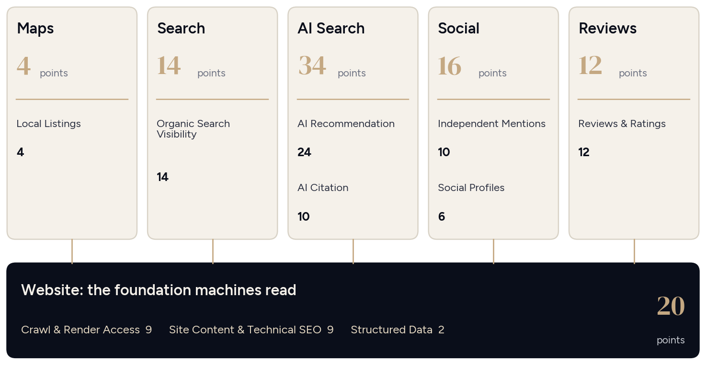
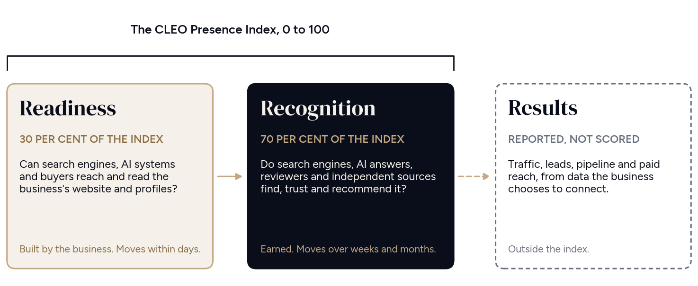
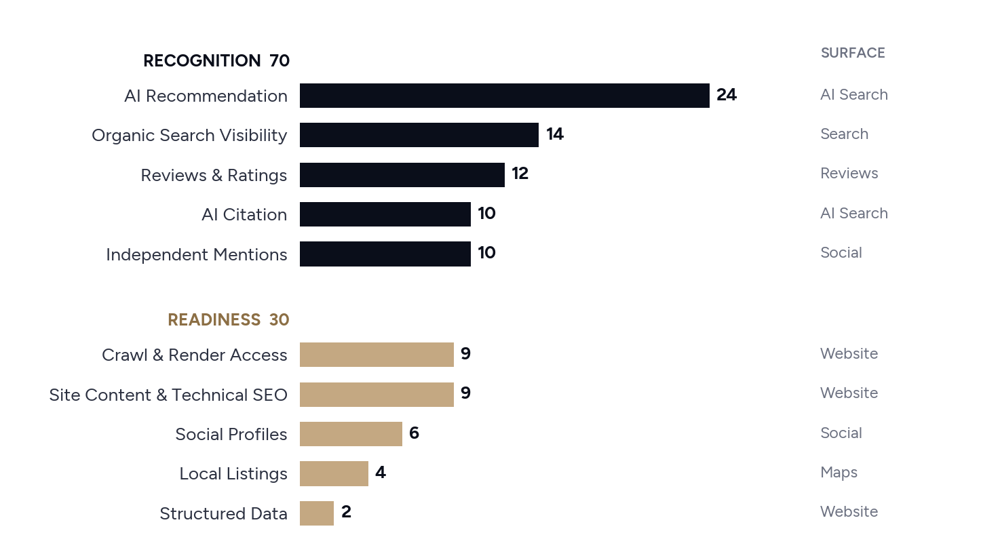
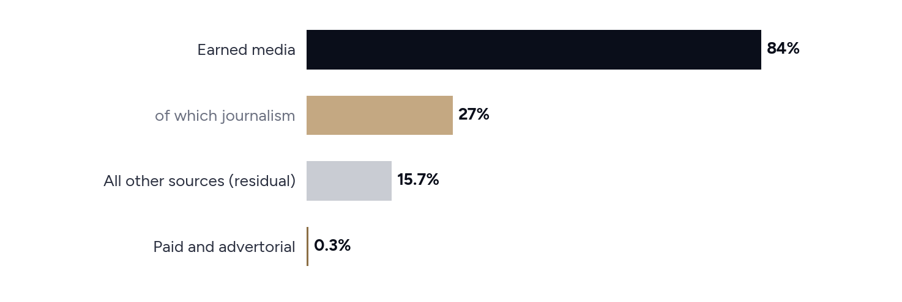
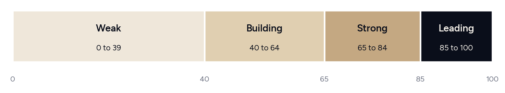

**CLEO PRESENCE INDEX**

Presence, measured

The CLEO Presence Index methodology, version 1.0, and an open invitation to improve it

Methodology, version 1.0 | September 2026

CLEO by RegenAI | regencleo.ai

# In brief

Buyers now meet a business on five surfaces before they reach its website: Maps, Search, AI Search, Social and Reviews. AI answers compress those surfaces into a short list of names, and a business that is not named is rarely considered. The CLEO Presence Index measures how present a business is across all five surfaces and the website beneath them, on one scale from 0 to 100, from the outside, and in the same way for every business.

|  |
| --- |
| Presence is the extent to which a business is found, trusted and recommended across the five surfaces buyers use, resting on a website that machines can reach and read. |

Four decisions define version 1.0.

**1.** **It separates what a business builds from what it earns.** Presence Readiness, 30 per cent of the index, asks whether search engines, AI systems and buyers can reach and read the business's website and profiles. Presence Recognition, 70 per cent, asks whether search engines, AI answers, reviewers and independent sources find, trust and recommend it. Outcomes carry more weight because outcomes are what buyers see.

**2.** **It counts only what can be attributed.** Press releases, wire syndication and paid placements earn nothing on their own. The independent coverage and AI answers they lead to are counted once, weighted by the credibility of the source.

**3.** **It measures every business the same way.** Every input is observable from outside and collected from shared question sets for each category and market. The score a business sees in CLEO, on the free scan and on the public leaderboard is one number, computed one way. A public scan reads fewer sources than the full method, so its scores show their coverage and stay Provisional (Appendix D).

**4.** **It reports its own certainty.** Every score shows its coverage and a 95 per cent confidence range. A grade appears only when at least 80 per cent of the method is measured, and movement is reported only when it exceeds measurement noise.

CLEO stewards the index and publishes the full method: signals, weights, scoring curves and rules. Version 1.0 opens a public comment window for version 1.1, with four open questions on which we want the field's best thinking (section 10).

# 1. Buyers meet a business on five surfaces, and AI answers compress them into a few names

Discovery no longer happens in one place. A buyer may meet a business on a map, in a search result, in an AI answer, in a community thread or on a review site, and form a view before visiting its website. CLEO groups these into five surfaces: Maps, Search, AI Search, Social and Reviews. The website sits beneath them as the foundation that machines read; it is not a sixth surface.

AI answers raise the stakes because they compress. Where a results page offers many links, an AI answer usually offers a short list of names, so being named, or not, becomes decisive. Use is growing fast: in BrightLocal's 2026 survey of US consumers, the share of consumers using AI tools for local business recommendations rose from 6 per cent to 45 per cent in a year [1].

AI answers are also unstable. In research by SparkToro and Gumshoe, the same question put to AI tools repeatedly almost never produced the same list of brands: fewer than one run in a hundred matched. Yet how often a given brand appeared across many runs was stable enough to measure [2]. That finding shapes the whole method: sample widely, report rates rather than single answers, and state the uncertainty.

Existing measures each see one surface. AI visibility tools track answers, search tools track rankings and review platforms track ratings. None tells a business how present it is overall, or where the gap is. The CLEO Presence Index does both: one number, and a breakdown by surface and signal that shows where to act.

**EXHIBIT 1**

**Ten signals across five surfaces and the website foundation**

**Source:** CLEO Presence Index methodology, version 1.0. Points are weights out of 100.

# 2. Presence has two layers: the readiness a business builds and the recognition it earns

The index groups its ten signals into two layers, each answering a question a team can act on.

**Presence Readiness (30 per cent)** asks whether search engines, AI systems and buyers can reach and read the business. It covers crawl and render access, site content and technical SEO, structured data, social profiles and local listings. These are largely within the business's control, and they change within days of a fix.

**Presence Recognition (70 per cent)** asks whether search engines, AI answers, reviewers and independent sources find, trust and recommend the business. It covers AI recommendation, AI citation, organic search visibility, reviews and ratings, and independent mentions. These are earned, and they move over weeks and months.

Recognition carries more weight because it is what buyers experience. A technically perfect website that nobody recommends should not score well. Readiness still carries real weight because it is where improvement starts: a site that machines cannot read cannot be ranked, cited or recommended, and Readiness shows the first gains.

**EXHIBIT 2**

**The index measures what a business builds and what it earns; results are reported alongside**

**Source:** CLEO Presence Index methodology, version 1.0.

**Results sit outside the index.** Traffic, leads, pipeline and paid reach matter most to a business, but they depend on data only the business can grant, and paid reach can be bought. CLEO reports them alongside the index, from connected data, and never inside it. That keeps the index comparable across businesses and keeps paid media from inflating a measure of organic presence.

**Why not owned and earned?** Earlier versions split the index into owned and earned presence. That split describes who controls a channel. It does not tell a team what to do next, and several signals sit awkwardly on either side of it. Presence Readiness and Presence Recognition describe cause and effect: build what machines and buyers need, then earn what they give. Readiness is largely what a business owns and Recognition largely what it earns, so the familiar distinction survives, but the labels now say what to do next. Version 1.0 retires the owned and earned labels.

# 3. Ten signals, weighted by how directly each shapes what buyers see

Each signal is scored from 0 to 100 and weighted. Weights sum to 100, so a signal's weight is the most it can contribute to the index. Exhibit 3 shows the weights and Exhibit 4 explains each signal in plain language; full definitions are in Appendix A. The construction follows the approach set out in the OECD and European Commission Joint Research Centre handbook on composite indicators: a defined concept, selected indicators, normalisation, weighting, aggregation and robustness testing [10].

**EXHIBIT 3**

**Signal weights, by layer**

**Source:** CLEO Presence Index methodology, version 1.0.

Weights in version 1.0 are published judgements informed by the evidence below. We state where the evidence is strong and where it is thin. Before each release, CLEO tests how scores and rankings change when each weight moves 25 per cent either way, and publishes the result. Each public scan publishes the same test with its ranking (Appendix D). A later major version will calibrate the weights against observed outcomes.

* **AI Recommendation carries the most weight (24)** because being named as an answer is the outcome buyers see in AI search, and appearance rates across many runs can be measured even though individual answers vary [2].
* **Organic Search Visibility (14)** remains a distinct surface. Google's guidance is that optimising for its generative AI features is still SEO [3].
* **Reviews and Ratings (12)** are a primary trust signal for buyers and a source AI answers draw on, particularly for local businesses.
* **Independent Mentions (10):** in an Ahrefs study of 75,000 brands, branded web mentions correlated more strongly with visibility in Google's AI Overviews (0.664) than backlinks did (0.218) [4].
* **Crawl and Render Access (9):** In a December 2024 analysis by Vercel and MERJ, none of the major AI crawlers rendered JavaScript except Google's Gemini, which uses Googlebot, and AppleBot. For the others, content that appears only after scripts run is invisible [5].
* **Structured Data (2)** is kept as hygiene: in a controlled Ahrefs study of 1,885 pages, adding schema produced no meaningful uplift in AI citations [6].

**EXHIBIT 4**

**The ten signals in plain language**

| **Signal** | **Weight** | **Surface** | **What it measures** |
| --- | --- | --- | --- |
| **RECOGNITION, 70** | | | |
| **AI Recommendation** | 24 | AI Search | How often AI answers to the questions buyers ask in the category name the business as an answer. |
| **Organic Search Visibility** | 14 | Search | How visible the business's pages are in unpaid search results for the category's keywords, weighted by search volume. |
| **Reviews & Ratings** | 12 | Reviews | The business's rating, adjusted for how many reviews support it, and its review volume, on the platforms that matter in its category. |
| **AI Citation** | 10 | AI Search | How often AI answers in the category link to the business's own pages as a source. |
| **Independent Mentions** | 10 | Social | Coverage and discussion from sources the business neither owns nor pays for, weighted by credibility and recency. |
| **READINESS, 30** | | | |
| **Crawl & Render Access** | 9 | Website | Whether the agents that fetch pages for search and AI answers can reach the site, and whether its content is in the HTML without running scripts. |
| **Site Content & Technical SEO** | 9 | Website | Titles, headings, internal linking, page experience, content depth and freshness. |
| **Social Profiles** | 6 | Social | Whether the business has profiles on the platforms that matter in its category, linked from its website or its structured data. |
| **Local Listings** | 4 | Maps | For businesses with a location or service area: presence and consistency of name, address, phone, hours and categories on the main local platforms. |
| **Structured Data** | 2 | Website | Valid organisation and page-type markup that helps machines identify the business. |

**Source:** CLEO Presence Index methodology, version 1.0. Full definitions in Appendix A.

# 4. Independent coverage counts; press releases do not

The most common question about any presence measure is whether publicity counts. Version 1.0 answers it directly. A press release is something a business puts out; presence is what others do with it. The index counts the second, not the first.

The evidence points the same way. Muck Rack's May 2026 study of more than 25 million links cited by ChatGPT, Claude and Gemini across 17 industries found that earned media accounted for 84 per cent of citations and journalism alone for 27 per cent, while paid and advertorial content accounted for 0.3 per cent [7]. Earned media's share stayed between 82 and 89 per cent across the study's three editions since July 2025. Press releases themselves were a small and unstable share: about 1.2 per cent of citations in July 2025, about 6 per cent in December 2025, and back near the July level by May 2026, mostly because ChatGPT cited them less often [7]. An academic study from the University of Toronto likewise found a systematic bias in AI search towards earned media over brand-owned content [11].

The measurement profession reached the same conclusion from a different direction. The Barcelona Principles 4.0, published by AMEC in 2025, reject advertising value equivalents and call for communication to be measured and evaluated by its outcome and impact [8].

**EXHIBIT 5**

**Earned media dominates the sources AI answers cite**

Share of AI citations by source type, May 2026, per cent

**Source:** Muck Rack, What Is AI Reading?, May 2026 edition: more than 25 million links cited by ChatGPT, Claude and Gemini across 17 industries. Journalism is a subset of earned media. The residual is 100 minus earned and paid.

**What counts.** Independent Mentions counts coverage and discussion from sources the business neither owns nor pays for. Each story counts once, at the credibility tier of the best source that carried it, and its weight halves every 180 days, in line with the finding that most journalism cited by AI is less than a year old [7]. Four kinds of content are excluded before anything is counted: the business's own channels; wire releases and syndicated copies of them; paid, sponsored or advertorial placements; and negative coverage.

**EXHIBIT 6**

**How one announcement is scored**

| **What happens** | **Credit in the index** |
| --- | --- |
| The release is distributed on a wire service | None |
| Fifty partner sites carry syndicated copies | None |
| The release is posted on the business's own newsroom | None directly; if AI answers cite the page, AI Citation counts it |
| A trade publication writes its own story about the announcement | One independent mention, trade tier |
| A national newspaper reports it under a named journalist | One independent mention, top tier |
| A sponsored article covers the announcement | None |
| An AI answer later names the business, citing the newspaper story | Counted in AI Recommendation; the Citation Loop in CLEO shows the path |

**Source:** CLEO Presence Index methodology, version 1.0.

The effect is practical. A business improves its score by earning coverage, not by distributing releases, and the Citation Loop in CLEO shows which articles carry it into AI answers.

# 5. Every business is measured the same way, from the outside

An index is useful only if two scores mean the same thing. Version 1.0 therefore uses only inputs that can be observed without the business's cooperation: public search results, AI answers, review platforms, public web pages and local listings. Data a business chooses to connect, such as analytics or Search Console, powers CLEO's diagnostics and results reporting. It never enters the index. The score in CLEO, on the free scan and on the public leaderboard is therefore the same number, computed the same way. A public scan computes it the same way from fewer sources, as Appendix D sets out.

**Shared question sets.** For each category and market, CLEO maintains a panel: 60 unbranded questions buyers ask, covering the category, their problem, comparisons, local needs and specific types of buyer, and 100 to 150 search keywords. Each question runs six times on each engine in every 28-day window, and keywords are checked weekly. Every business in the category is scored from the same answers and results. Panels are frozen before each window and published when it closes, so the method can be audited without being gamed while a window is open. In the UAE, panels run in English and Arabic.

**A standard engine set.** The index uses a fixed set of AI engines for every business, weighted by how much each is used, because an answer seen by more buyers matters more; the same logic weights search keywords by volume. The weights follow a published rule rather than judgement (Exhibit 7). Google AI Overviews and AI Mode are held at 25 per cent, because they sit inside Google Search, which trackers of standalone assistants do not measure. The remaining 75 per cent is split across the assistants by their average share of use on two independent trackers, one measuring web visits and one measuring unique users across mobile apps and the web [12, 13], with a floor of 5 per cent, and recalculated at every release. Weights follow use rather than referral clicks: presence is about being seen in answers, and clicks are results.

Engines are queried with web search enabled and without logins or personalisation, through their providers' official interfaces or through data providers that collect the answers from the public apps and from Google's results (Appendix D). Scores therefore reflect what a new buyer is likely to see. CLEO's product tracks more engines for diagnostics; the index uses the standard set so that scores stay comparable.

**EXHIBIT 7**

**The standard engine set, version 1.0**

| **Engine** | **Weight** | **How it is measured** |
| --- | --- | --- |
| **ChatGPT** | 41% | OpenAI's official API with web search, or chatgpt.com answers collected by a data provider |
| **Google AI Overviews and AI Mode** | 25% | Licensed search results data |
| **Gemini** | 21% | Google's official API, with search grounding |
| **Claude** | 8% | Anthropic's official API, with web search |
| **Perplexity** | 5% | Perplexity's official API |

**Source:** Similarweb worldwide web-visit share, August 2026 reading, published 7 September 2026 (ChatGPT 55.5%, Gemini 25.6%, Claude 9.3%, Perplexity 0.9%); Sensor Tower True Audience share, unique users across mobile apps and web, end of May 2026 (ChatGPT 46.4%, Gemini 27.7%, Claude 10.3%). Assistant weights are the average of the two, re-normalised across 75 per cent; Perplexity sits at the 5 per cent floor. Google AI Overviews and AI Mode are held at 25 per cent. Recalculated at each release.

**Data routes.** The index uses official APIs where they exist, data bought from data providers, and public pages. Some sources have no official route for this use. For those, the index buys data that providers collect from public pages: ChatGPT answers, Google Maps listings, Trustpilot ratings, and Reddit and LinkedIn posts. ChatGPT is read from chatgpt.com because that is the answer a buyer sees, from the model the app picks, which OpenAI's API does not give. Appendix D lists every source and its route. Where no comparable data exists, as with social engagement and review recency, the index does not measure it yet, and says so.

# 6. Every score reports how much it rests on and how certain it is

**From measurement to score.** Each signal starts as a raw measure, such as the share of answers that recommend the business. A published curve converts it to a score from 0 to 100 using two reference points: the level that scores 50 and the level that scores 90. The reference points are set from the distribution of measured businesses and then frozen for the version, the approach Google's Lighthouse uses for web performance scores [9]. Version 1.0 launches with published judgement anchors; the first calibration takes place at the end of the first 28-day measurement window, and from then on a score of 50 marks the median among businesses with any measured presence on that signal and 90 marks the top decile. Because the curves stay fixed between calibrations, a score moves when the business moves, not when its competitors do.

**From signals to index.** The index is the weighted average of the signals that are live. Coverage is the share of applicable weight that is live. A signal that cannot apply to a business, such as local listings for an online-only business, is excluded from both. Measuring nothing is not the same as measuring zero: a business with no reviews scores zero on Reviews, while a signal CLEO cannot yet measure lowers coverage instead.

**EXHIBIT 8**

**Signal states**

| **State** | **Meaning** | **Effect on the score** |
| --- | --- | --- |
| **Live** | Enough data to score. | Counts in the index and in coverage. |
| **Warming up** | A new category panel has not yet collected enough answers, typically in its first 28 days. | Excluded from the index; lowers coverage. |
| **Not measured** | Data could not be collected, for example because the site blocks CLEO's crawler. | Excluded from the index; lowers coverage. |
| **Not applicable** | The signal cannot apply to the business, under published rules. | Excluded from the index and from coverage. |

**Source:** CLEO Presence Index methodology, version 1.0.

**Certainty.** AI signals are proportions measured from hundreds of answers, so each carries a 95 per cent Wilson interval, the same standard CLEO applies across its AI reporting. With 360 answers from an engine and a true rate of 20 per cent, the interval is about 4.1 points either side. The index is shown with its 95 per cent range.

**Movement.** The trend line is smoothed to damp day-to-day noise. A change is reported only when it exceeds the minimum detectable change: the smallest difference that measurement noise cannot explain. Comparisons are like for like, using only signals and engines measured at both ends of the period, so a signal or engine coming online never appears as movement. Method changes are marked on the chart.

**EXHIBIT 9**

**Three illustrative businesses**

|  | **Business A** | **Business B** | **Business C** |
| --- | --- | --- | --- |
| **Situation** | All signals live | Online only; Local Listings not applicable | New category panel; AI signals warming up |
| **Readiness** | 78.1 | 79.3 | 65.8 |
| **Recognition** | 52.0 | 52.0 | 18.9, on organic search, reviews and mentions only |
| **Coverage** | 100% | 100% | 66% |
| **Index** | **59.8** | **59.4** | **40.2** |
| **Shown as** | Building | Building | Provisional, no grade |

**Source:** Illustrative figures. Business A signal scores: AI Recommendation 42, AI Citation 55, Organic Search Visibility 60, Reviews & Ratings 72, Independent Mentions 38, Crawl & Render Access 90, Site Content & Technical SEO 78, Social Profiles 65, Local Listings 70, Structured Data 80. Business B has the same scores without Local Listings. Business C: Organic Search Visibility 20, Reviews & Ratings 25, Independent Mentions 10, Crawl & Render Access 85, Site Content & Technical SEO 70, Social Profiles 40, Local Listings 55, Structured Data 60.

Business A's surface view shows where to act: Website 83.6, Reviews 72.0, Maps 70.0, Search 60.0, Social 48.1 and AI Search 45.8. Its foundations are strong; its gap is recognition in AI answers.

Business C shows why coverage matters. Its measured signals average 40.2, but a third of the method is not yet measured, so the index is shown as Provisional and no grade is given. When its AI signals go live, the index is recomputed on the full method; because the trend compares like with like, that change in measurement is not reported as a change in presence. For a business whose category panel is already running, AI signals are live from its first day.

# 7. Grades appear only when the evidence supports them

**EXHIBIT 10**

**Grade bands**

| **Band** | **Index** | **What it means** |
| --- | --- | --- |
| **Weak** | 0 to 39 | Rarely found or recommended; significant room to grow. |
| **Building** | 40 to 64 | Foundations in place; recognition is inconsistent. |
| **Strong** | 65 to 84 | Competitive presence across most surfaces. |
| **Leading** | 85 to 100 | A default answer across most of the category's questions. |

**Source:** CLEO Presence Index methodology, version 1.0.

The bands are unchanged from earlier versions. Two rules make them trustworthy.

* **Coverage gating.** A grade is shown only when coverage is at least 80 per cent (Rated). Between 50 and 79 per cent, the index is shown as Provisional, without a grade. Below 50 per cent, no index is shown (Unrated) and the live signals are shown on their own.
* **Stability.** A grade changes only after the smoothed index has stayed at least 1.5 points beyond a band boundary for seven consecutive days, so a business does not flicker between grades on noise.

# 8. What the index tells you, and what it does not

| **It tells you** | **It does not tell you** |
| --- | --- |
| How present a business is across the five surfaces and its website, against a fixed standard | How much revenue presence produces; results are reported separately |
| Where the gap is, by layer, surface and signal | What any single AI answer will say to any single buyer |
| Whether presence is changing by more than measurement noise | Why an individual engine favours one business over another |
| How much of the method a score rests on, and how certain it is | Whether AI answers describe the business accurately (open question 1) |
| How a business compares with others in its category on the same questions | How a business appears in a personalised, logged-in session |

# 9. An open, versioned method keeps the index honest

A measure that sets a category's standard has to be open to challenge. CLEO stewards the index and commits to the rules in Exhibit 11.

**EXHIBIT 11**

**How the index is governed**

| **Area** | **Rule** |
| --- | --- |
| **Versioning** | Every score carries the version that produced it. Major versions change signals, weights or structure; minor versions refine sub-metrics, curves and engine weights; patches fix errors. |
| **Releases** | Up to two releases a year, each preceded by a public comment window of at least 30 days. |
| **Decisions** | CLEO's methodology lead decides. An external review panel will advise once it is formed, and its members and advice will be published. Every proposal receives a published response with reasons. |
| **History** | After a major version, each business's history is recalculated for the prior 90 days so trends stay comparable, with the version change marked. The public leaderboard shows only current-version scores. |
| **Openness** | The methodology text is published under the Creative Commons Attribution 4.0 licence and the reference calculator is open source under the Apache 2.0 licence. The name CLEO Presence Index is reserved to CLEO; others may describe a score as based on the CLEO Presence Index methodology. |
| **Independence** | No business can pay to change its score. Clients and non-clients are measured on the same frozen panels, with no manual adjustment. CLEO does not create or rank a leaderboard category in which it competes, and publishes its own index as a worked example. |
| **Integrity** | Panels rotate by no more than 20 per cent a quarter. Coordinated or paid attempts to manipulate any input are excluded when detected, and the exclusion is disclosed. |
| **Corrections** | Any business can request a review of the data behind its score. Confirmed errors are corrected and logged. |
| **Leaderboard** | Public entries must be Rated, on the current version and approved for publication. Each shows its score, 95 per cent range and coverage. |

**Source:** CLEO Presence Index methodology, version 1.0.

# 10. Help shape how presence is measured

Version 1.0 is a start, not a settlement. We invite agencies, search and AI practitioners, researchers, publishers and businesses to test it, challenge it and propose improvements to any part of the method: signals, weights, sources, curves, panels, engines and rules.

**What makes a strong proposal.** A clear mechanism for why the change would make the index a better measure of presence; evidence from at least two independent datasets or one controlled experiment; and an estimate of how the change would move existing scores. Proposals that would make the index easier to game, or that depend on data that cannot be collected lawfully and comparably, will not be adopted.

**EXHIBIT 12**

**Four open questions for version 1.1**

|  | **Question** | **Why it matters** |
| --- | --- | --- |
| **1** | **Answer accuracy.** Should the index score whether AI engines describe a business correctly, and how can the facts be established fairly for businesses that have not supplied them? | Being named is not enough if the answer gets the business wrong. |
| **2** | **Local businesses.** Should Maps carry more weight for businesses that serve a location, and how should map and local-pack visibility be measured comparably? | For local businesses, the map is often the first surface a buyer sees. |
| **3** | **Social activity.** Which lawful, comparable measures of social activity and engagement exist across platforms? | Version 1.0 measures profiles, not activity, because comparable activity data is not yet lawfully available. |
| **4** | **Markets, languages and buyers.** How should engine weights and panel languages vary by market and by type of buyer, starting with English and Arabic in the UAE, and with business buyers? | Usage differs by market and by buyer. One study of business-to-business sites found Claude sending 18.5 per cent of their AI referrals in March and April 2026 [14], against roughly 9 to 10 per cent of overall assistant use [12, 13]. |

**Source:** CLEO Presence Index methodology, version 1.0.

**EXHIBIT 13**

**How to take part**

| **Step** | **What to do** |
| --- | --- |
| **1. Read the method** | The full specification, reference calculator and change log are in the public repository: https://github.com/RegenCLEO/presence-index. |
| **2. Propose a change** | Open a proposal in the repository using the template in Appendix C, or email contact@regencleo.ai. Proposals are published. |
| **3. Comment** | Each release has a comment window of at least 30 days. Anyone may comment on open proposals. |
| **4. See the decision** | Every proposal receives a published response with reasons. Adopted changes are credited to their proposers. |

The first comment window runs for 30 days from publication.

# Appendix A. Signal definitions

Weights, scoring curves and coverage thresholds are published in `config/cpi-1.0.0.yaml` in the repository.

| **Signal** | **Measured as** | **Main sources** | **Applies to** |
| --- | --- | --- | --- |
| **RECOGNITION, 70** | | | |
| **AI Recommendation (24)** | Share of answers to the category panel that recommend the business (1), name it without recommending it (0.5), or omit it or name it negatively (0), averaged across engines by engine weight. Live from 200 valid answers per engine, for engines carrying at least 70 per cent of engine weight. | Standard engine set | All businesses |
| **AI Citation (10)** | Among answers that cite sources, the share citing at least one page on the business's own domains. | Standard engine set | All businesses |
| **Organic Search Visibility (14)** | Visibility of the business's pages in the top 10 unpaid results for the keyword panel, weighted by search volume and Advanced Web Ranking's published click-through curve for unbranded queries [15]; four-week average. | Licensed search results data | All businesses |
| **Reviews & Ratings (12)** | Rating adjusted towards the category average when reviews are few (60 per cent, scaled by the weight of review evidence) and review volume (40 per cent), pooled across up to four platforms per category. No reviews scores zero. | Review platforms with lawful access | All businesses, unless the category has no public review platform |
| **Independent Mentions (10)** | Independent stories and threads from the last 365 days, weighted by source tier (top 3.0; trade and reference 1.5; other 0.5; community threads 1.0) and halving in weight every 180 days, after exclusions and deduplication. | News index, search results, sources cited in AI answers, Wikipedia and Wikidata, YouTube titles and descriptions | All businesses |
| **READINESS, 30** | | | |
| **Crawl & Render Access (9)** | Access for the agents that fetch pages for search and AI answers (40), content present in the HTML without running scripts (35), and indexability of key pages (25). Blocking AI training crawlers is reported, not penalised. | CLEO crawler and renderer | All businesses |
| **Site Content & Technical SEO (9)** | Titles and descriptions (15), headings (10), internal link depth (15), Core Web Vitals using field data where available (20), content depth and uniqueness (25), freshness (15). | CLEO crawler; Chrome UX Report | All businesses |
| **Social Profiles (6)** | Share of the category's primary platforms, up to four, on which the business has a profile linked from its website or declared in its structured data. | CLEO crawler | All businesses |
| **Local Listings (4)** | Presence on the market's main local platforms (40), consistency of name, address and phone with the website (40), hours and categories present (20). | Local platform data with lawful access | Businesses with a location or service area |
| **Structured Data (2)** | Valid organisation or local business markup with profile links (50), page-type markup on key pages (30), no validation errors (20). An llms.txt file is reported but not scored. | CLEO crawler | All businesses |

# Appendix B. Glossary

| **Term** | **Meaning** |
| --- | --- |
| **Coverage** | The share of applicable signal weight that is live. |
| **Curve** | The published function converting a raw measure to a score from 0 to 100, defined by the levels scoring 50 and 90. |
| **Engine set** | The fixed AI engines used for the index, with their weights. |
| **Independent mention** | Coverage or discussion from a source the business neither owns nor pays for. |
| **Minimum detectable change** | The smallest change in the index that measurement noise cannot explain, at 95 per cent confidence. |
| **Panel** | The frozen set of questions and keywords for a category and market. |
| **Presence Readiness** | The layer measuring whether search engines, AI systems and buyers can reach and read the business. Short form: Readiness. |
| **Presence Recognition** | The layer measuring whether the business is found, trusted and recommended. Short form: Recognition. |
| **Provisional** | An index based on 50 to 79 per cent coverage, shown without a grade. |
| **Rated** | An index based on at least 80 per cent coverage, shown with a grade. |
| **Results** | Traffic, leads, pipeline and paid reach, reported alongside the index and never inside it. |
| **Surface** | One of the five places buyers meet a business: Maps, Search, AI Search, Social and Reviews. |
| **Wilson interval** | A confidence interval for a proportion that stays reliable when the proportion is small. |

# Appendix C. Proposal template

| **Field** | **What to include** |
| --- | --- |
| **Title** | A short name for the change. |
| **Proposer** | Name and affiliation, with any commercial interest disclosed. |
| **Part of the method** | The signal, weight, source, curve, panel, engine or rule affected. |
| **Proposed change** | Precise wording or formula. |
| **Mechanism** | Why the change makes the index a better measure of presence. |
| **Evidence** | Datasets or experiments, with links. |
| **Effect on scores** | Estimated movement in existing scores and rankings. |
| **Data** | What is needed, and how it can be collected lawfully and comparably. |
| **Gaming risk** | How the change could be gamed, and how to prevent it. |

# Appendix D. Public scan protocol PS-1.0

The public scan measures the brands of one category on one day, from the outside, before any of them has connected to CLEO. It uses the scoring maths of version 1.0 unchanged. This appendix lists the rules it adds and the places where it measures less than the full method. The code that runs it is in `scan/` in the public repository.

| **Area** | **Rule** |
| --- | --- |
| **Questions** | 60 unbranded questions, each asked twice on each engine on one day, as separate calls. The panel is frozen and hashed before the first call. |
| **Brands** | The panel lists the brands and names the outside source they come from. A business the answers name can be added after the scan, up to the limit the panel sets, once a person has confirmed its domain. So can another spelling of a listed brand. Additions are recorded beside the results and leave the panel hash unchanged. |
| **Engines** | ChatGPT, Google AI Overviews, Gemini and Claude, with the weights in Exhibit 7. Perplexity is not asked, and the scan has no way to ask it. Google is asked for AI Overviews only, not AI Mode, and keeps its 25 per cent. Weights are renormalised across the engines that count. With all four counting they are ChatGPT 43, Google AI Overviews 26, Gemini 22 and Claude 8 per cent (41, 25, 21 and 8 over 95). |
| **Reading answers** | A brand is looked for in an answer by its name, its other spellings and its domains. Where none appears, the answer scores 0 for that brand. Otherwise two different AI models each read the answer and label the brand as recommended, named or absent, and a third model settles a disagreement. A search that shows no AI Overview is not a valid answer and is left out of the rate. |
| **Keywords** | 100 unbranded keywords, pulled once in each of two calendar weeks from Google's desktop top 10 for the panel's country. A keyword with no known search volume counts as 10 searches a month. |
| **Signals measured** | All ten can be measured. Seven come from the scan's own answers, keyword pulls and site reads: AI Recommendation, AI Citation, Organic Search Visibility, Crawl & Render Access, Site Content & Technical SEO, Social Profiles and Structured Data. These carry 74 of the 100 points. Reviews & Ratings, Independent Mentions and Local Listings come from outside sources, each read by its own stage, and carry the other 26. A scan that does not run one of those stages records its signal as not measured for every brand, never as not applicable. Each signal is read from fewer sources than the full method, so a public scan score stays Provisional and carries no grade, whatever its coverage. |
| **Reviews & Ratings** | Trustpilot only: the rating and review count of the profile for each of the brand's domains. A brand with several profiles is scored on the one with the most reviews, because they are one platform. A profile with no reviews scores 0. A brand with no Trustpilot profile is not measured, because one platform says nothing of the rest. Review recency is not measured. |
| **Independent Mentions** | Mentions of the past 365 days from these sources: the pages the AI answers in this scan cite, Bluesky's post search, YouTube's video search, Reddit posts and LinkedIn posts. A scan names the sources it read with its results, and every brand is read from the same ones. The panel's first reader model reads each post and search result and keeps only those about the business, not another use of the same word. A cited page is not put to the model. The brand's own pages, wire releases and paid or sponsored content do not count. Discussion sites (YouTube, LinkedIn, Reddit and similar) are community sources, counted at most three times per community and 30 days. Wikipedia and pages a person has judged to be publishers are tier B, and all other pages tier C, because no register of tier A outlets exists yet. |
| **Local Listings** | Google Maps only: one search for the brand's name in the panel's country. The brand's listing is the first place whose title is the brand's and whose website is on the brand's domains. Presence and name, address and phone consistency are 1 when it has one and 0 when not. The address and phone are not compared with the brand's site, because the scan reads none from it. Hours and category are 1 when the listing shows both. A brand with no place to visit, set by a person in the panel, is not applicable. A search that returns no place at all is not measured. |
| **Data routes** | ChatGPT is asked through a data provider's scraper of chatgpt.com, so the app picks the model. Claude is asked through Anthropic's API, and Gemini through Google's Vertex AI. Google AI Overviews, Google's organic results and Google Maps are read through a search results data provider, and Trustpilot through a business data provider. Bluesky posts come from Bluesky's public API and YouTube videos from the YouTube Data API. Reddit and LinkedIn posts are bought from a provider that collects them from public pages. Lighthouse scores come from Google's PageSpeed Insights API. The scan reads brand websites itself, as CleoCrawler, and obeys their robots.txt. The scan's README names the provider behind each bought route. |
| **When AI signals are live** | Each question counts once, as the mean of its valid answers. An engine counts from 60 valid answers on at least 10 questions. For AI Citation only answers that cite a source are counted, so an engine can count for AI Recommendation and not for AI Citation. An AI signal is live when the engines that count carry at least half the weight of the engines asked. These thresholds stand in for the 200 answers and 70 per cent of Appendix A, which describe a full 28-day window. |
| **Organic Search Visibility** | Live from pulls of the whole keyword panel in two calendar weeks. The rate is the mean of the weekly values, of which a standard scan has two. |
| **Crawl & Render Access** | Read on the homepage and up to 19 more pages of the brand's site, taken from the pages the answers cite and the pages that rank for the keywords, most frequent first. The scan runs no browser. A page counts as having its content in the HTML when the raw HTML holds at least 50 words outside its script, style, navigation, header and footer elements. A page the scan cannot read is left out of the shares, because that says nothing about readiness. This covers a page that blocks CLEO's crawler, a failed request, a redirect off the brand's site and a reply that is not HTML. The scan never works around a block. |
| **Homepage not read** | A brand whose homepage the scan cannot read has its four website and social signals recorded as not measured. Its coverage is then below 50 per cent, so it has no index. |
| **Site Content & Technical SEO** | Measured on the homepage only. 60 points are the SEO category score of Google's Lighthouse, read from PageSpeed Insights on its mobile setting. 40 points are five facts in the homepage HTML, worth 8 each: a title, a meta description, one canonical URL, an h1 heading with text, and the share of images with an alt attribute. A homepage with no images earns those 8 points. This is narrower than the composition in Appendix A, which needs a crawl of the whole site. A homepage Lighthouse cannot score has no score. |
| **Social Profiles** | The four platforms are LinkedIn, Instagram, X and Facebook. A link to a share button or to a single post is not a profile. |
| **Structured Data** | Organisation markup is read on the homepage. Page-type markup is read on the other pages. |
| **Comparable brands** | A signal counts for a scan when it is live for at least half the brands. A signal below that is recorded as not measured for every brand. A brand that lacks a signal that counts is not ranked. |
| **Ranges** | Answers are grouped by question before the error is computed, because two answers to one question are not independent. The error is turned into an effective sample size, and the 95 per cent Wilson interval is taken on that sample. Where no engine's values differ from one question to the next, the error is zero and the effective sample is undefined, so the interval is taken on the number of questions in the panel. The index range is 1.96 standard errors either side of the unrounded index, with each end then rounded to one decimal. Its error comes from the two AI signals and from Organic Search Visibility. |
| **Ranks** | Brands are sorted by the unrounded index. The first brand anchors the first tier. Each following brand joins the tier if the upper end of its range reaches the lower end of the anchor's range. Otherwise it anchors a new tier. Brands in a tier share a rank, shown as "1=". The next tier's rank counts every brand above it, as in 1=, 1=, 3. Inside a tier the order is index, then recommendation rate, then name. |
| **Leader** | The first tier. Two or three brands in it are joint leaders. With more than three, no leader is declared. |
| **Stability** | Which engines count is decided once on both runs together. The ranked brands are then sorted by index for each run on its own, on the questions both runs answered, without ranges or tiers. If the top three brands of the two runs differ, the scan needs a second day. Brands level at third place all count as top three. A second day's answers are pooled with the first day's, question by question. |
| **Publication** | The public table ends at row ten and says how many unpublished brands share the tenth rank. An unranked brand is named on a separate line, with its rate and the reason it has no rank, when its recommendation rate is above zero and among the ten highest. Each ranking names its frozen panel file and its SHA-256, the model each engine and reader used, the version of the reader prompt, and the tagged release of the code that produced it. Each ranking also publishes its weight test: every signal weight is moved 25 per cent down and up, one at a time, and the indexes and ranks are rebuilt under the same rules. The result names only the published brands. |

**Source:** CLEO Presence Index methodology, version 1.0.

# References

**[1]** BrightLocal, Local Consumer Review Survey 2026.

**[2]** Rand Fishkin (SparkToro) with Patrick O'Donnell (Gumshoe), NEW Research: AIs are highly inconsistent when recommending brands or products, January 2026, sparktoro.com.

**[3]** Google Search Central, guidance on optimising for generative AI features in Google Search, 2026.

**[4]** Ahrefs, analysis of brand mentions and visibility in AI Overviews across 75,000 brands, ahrefs.com.

**[5]** Vercel, with MERJ, The rise of the AI crawler, December 2024.

**[6]** Ahrefs, controlled study of schema markup and AI citations across 1,885 pages, ahrefs.com.

**[7]** Muck Rack, What Is AI Reading?, May 2026 edition, with the July 2025 and December 2025 editions.

**[8]** AMEC, Barcelona Principles 4.0, 2025.

**[9]** Chrome for Developers, Lighthouse performance scoring.

**[10]** OECD and European Commission Joint Research Centre, Handbook on Constructing Composite Indicators: Methodology and User Guide, 2008.

**[11]** Chen, Wang, Chen and Koudas, Generative Engine Optimization: How to Dominate AI Search, University of Toronto, arXiv, 2025.

**[12]** Similarweb, Gen AI website traffic share update, August 2026, published 7 September 2026.

**[13]** Sensor Tower, State of AI 2026, June 2026, sensortower.com.

**[14]** Goodie, 2026 AI Search Traffic Report, 21 May 2026, higoodie.com.

**[15]** Advanced Web Ranking, Google Organic CTR Study, July 2026 snapshot.
